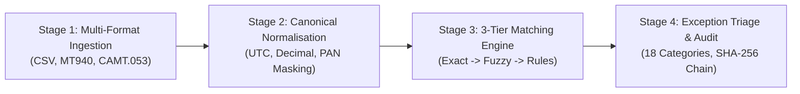

# PayBridge Reconciliation Engine: System Architecture

## 1. Executive Overview
The **PayBridge Automated Reconciliation Engine** is an enterprise financial infrastructure platform designed for high-velocity multi-bank settlement reconciliation across payment rails including UPI, NEFT, RTGS, IMPS, and card networks.

The engine parses heterogeneous statements (**SWIFT MT940, ISO 20022 CAMT.053, and proprietary bank CSV variants**), normalises them to a strict **10-field Canonical Data Model**, executes a **Three-Tier Matching Engine** (Exact O(N+M) Hash Composite, RapidFuzz Candidate-Blocked Fuzzy Matching, and Dynamic Programming Subset-Sum Rule Matching), classifies unmatched records into **18 standardized Exception Categories**, and enforces an **Append-Only Cryptographic Audit Trail with SHA-256 Hash Chaining**.

---

## 2. Four-Stage Pipeline Architecture

### Stage 1: Ingestion Layer
- **CSV Parser**: Streaming parser using Python standard `csv` module (O(1) memory footprint), supporting YAML-configurable column mappings for HDFC, ICICI, Axis, Yes Bank, and IndusInd.
- **SWIFT MT940 Parser**: State-machine parser handling tags `:20:`, `:25:`, `:28C:`, `:60F:`, `:61:`, `:86:`, `:62F:`, and 5 bank deviations (period decimals, missing funds codes, variable `:86:` subfields, extended references).
- **ISO 20022 CAMT.053 XML Parser**: XPath parser with XML namespace handling, nested `<NtryDtls>/<TxDtls>` extraction, and balance extraction (`OPBD`, `CLBD`, `CLAV`).
- **File Integrity & Schema Validation**: Computes SHA-256 hash on receipt to reject duplicate files (Scenario B4.4) and detects schema layout shifts (Scenario B4.1).

### Stage 2: Normalisation Pipeline
Executes transformation chain:
1. `timezone_normalise()`: Local bank time -> UTC while preserving local timestamp.
2. `currency_normalise()`: Validates ISO 4217, converts amounts to fixed-point `Decimal(0.0001)` using Banker's Rounding (`ROUND_HALF_EVEN`).
3. `reference_clean()`: Strips whitespace, standardises casing and delimiters.
4. `counterparty_clean()`: Expands corporate abbreviations ("Pvt Ltd", "LLP", "Inc").
5. `pan_mask()`: Enforces PCI DSS Requirement 3.3 by masking 13-19 digit card PANs (`************1234`).

### Stage 3: Three-Tier Matching Engine
- **Tier 1: Exact Hash Matching (O(N+M))**: Composite key `(txn_id + amount + currency + direction)` hash lookups with secondary disambiguation on narration and timestamp proximity. Resolves 80-85% of records in < 50ms.
- **Tier 2: Candidate-Blocked Fuzzy Matching**: Blocks candidates by amount ± tolerance and date ± 2 days, evaluating Jaro-Winkler (>0.92), Levenshtein (edit distance <= 2), and Token Set Ratio (>0.80).
- **Tier 3: Rule-Based & Subset-Sum Matching**:
  - *Split Transaction Detection*: Dynamic programming subset-sum solver matching 1 external record to 2-10 internal records.
  - *Netted Settlement Detection*: Reverse subset-sum matching 1 internal record to 2-10 external records.
  - *Amount & Date Tolerances*: Tolerances for same-currency (±0.01) and FX (1.5% tolerance band against RBI benchmark rates).

### Stage 4: 18-Category Exception Triage & Escalation
- Evaluates unmatched records into 18 categories with automated SLAs:
  - `DIRECTION_REVERSAL` (30 min critical SLA -> Tier 4 Compliance)
  - `AMOUNT_MISMATCH` (2 hour SLA)
  - `DUPLICATE_INTERNAL` (1 hour SLA -> Tier 1 Auto-Void)
  - `FEE_DEDUCTION` (2 hour SLA -> Tier 1 Auto-Adjust)
  - `REFERENCE_TRUNCATED` (2 hour SLA -> Tier 1 Prefix Match)
  - `REGULATORY_HOLD` (48 hour SLA -> Tier 4 Compliance)

---

## 3. Cryptographic Audit Trail Chaining

Every pipeline action creates an append-only block where:
$$\text{Block Hash} = \text{SHA256}(\text{EventID} + \text{Timestamp} + \text{Actor} + \text{Action} + \text{Records} + \text{Before} + \text{After} + \text{Rationale} + \text{PrevHash})$$

This creates a tamper-evident chain meeting **Section 128 of the Companies Act, 2013** and **RBI Cyber Security Guidelines**.
